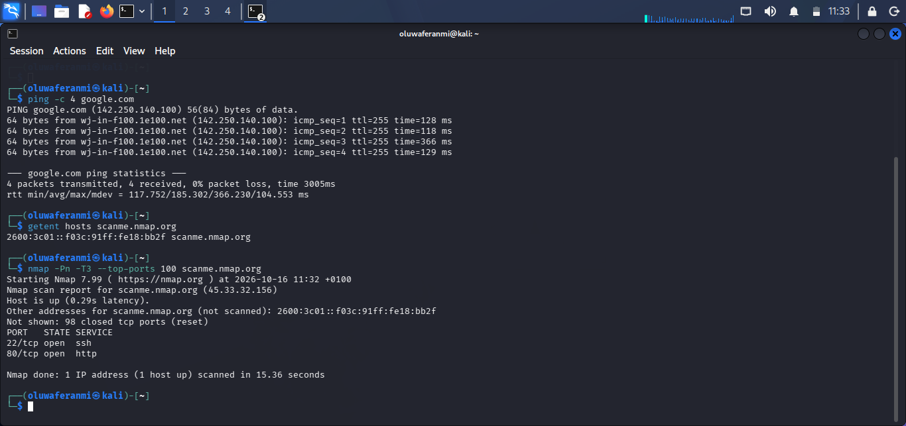

   Project 1: Network Reconnaissance Using Nmap

  Overview

This beginner cybersecurity project demonstrates basic network reconnaissance using Nmap in Kali Linux. The project involved scanning an authorized test server to identify open ports and associated network services.

 Objective

To learn how to identify open ports, understand network services, interpret scan results, and recognize potential security considerations.

 Tools Used

* Kali Linux
* Nmap 7.99
* GitHub

 Methodology

1. Verified the Nmap installation.
2. Selected the authorized test server, `scanme.nmap.org`.
3. Performed a basic TCP port scan.
4. Analyzed the scan results and identified open ports.
5. Documented the findings and security recommendations.

 Results

The scan completed successfully in 15.36 seconds.

* Target: `scanme.nmap.org`
* IP address: `45.33.32.156`
* Host status: Up
* Open port 22/TCP: SSH
* Open port 80/TCP: HTTP
* Closed TCP ports: 98

The scan identified two open ports associated with SSH and HTTP. Open ports do not automatically indicate vulnerabilities; further assessment would be required to determine whether any security weaknesses exist.

 Lessons Learned

* Gained practical experience using Nmap in Kali Linux.
* Learned how to identify open and closed TCP ports.
* Improved my understanding of common network services.
* Learned how to interpret scan results and document findings.
* Understood the importance of authorization and responsible security testing.

 Ethical Considerations

Testing was conducted against Nmap's designated test server, `scanme.nmap.org`, within its published usage restrictions. No exploitation or unauthorized access was attempted.

 Screenshot Evidence

The screenshot below shows the actual Nmap scan performed during this project.

 Security Findings and Recommendations

   Findings

* Port 22 (SSH):Open. This port is commonly used for secure remote administration.
* Port 80 (HTTP):Open. This port is commonly used for web traffic that is not encrypted by HTTP itself.
* Other scanned TCP ports:98 ports were reported as closed.

   Recommendations

* SSH:Restrict access to trusted sources where appropriate, use strong authentication, and keep the SSH service updated.
* HTTP:Where applicable, configure HTTPS to encrypt web traffic and protect information in transit.
* Port management:Close unnecessary services and limit network exposure based on operational requirements.

   Limitations

This was a basic Nmap scan. It identified port states and associated service names but did not establish whether the services contain vulnerabilities. Further authorized assessment would be required.

The recommendations are general security guidance, not confirmation that the target server is vulnerable.

